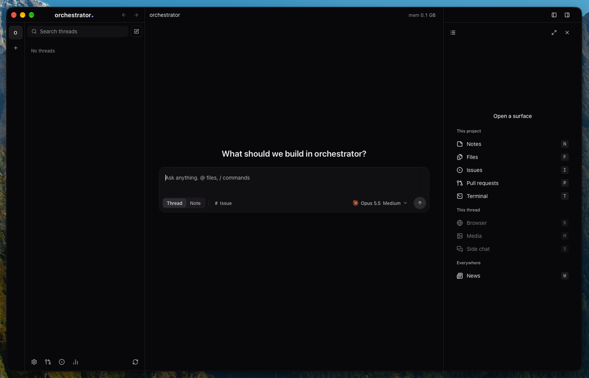

<div align="center">
  
  <h3><b>orchestrator</b></h3>
  <p>One desktop window for every coding-agent thread you run</p>
  <p>
    <a href="https://github.com/nednella/orchestrator/releases/latest"></a>
    
  </p>
</div>

<br>



<br>

## Install

You need a Mac with Apple silicon, [Claude Code](https://docs.claude.com/en/docs/claude-code), [tmux](https://github.com/tmux/tmux) and the [GitHub CLI](https://cli.github.com) 2.99 or later, logged in.

Then run:

```sh
curl -fsSL https://raw.githubusercontent.com/nednella/orchestrator/main/install.sh | bash
```

The install script verifies the download and lists any required software that's missing. No `sudo` required.

You get:

- `~/Applications/orchestrator.app`
- [agent-browser](https://github.com/vercel-labs/agent-browser), inside the app, which agents drive their browser with
- `~/Applications/Google Chrome for Testing.app`, the browser agents drive (kept as it is if you already have it)
